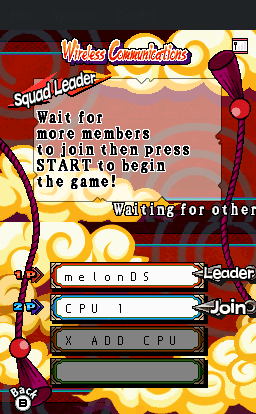
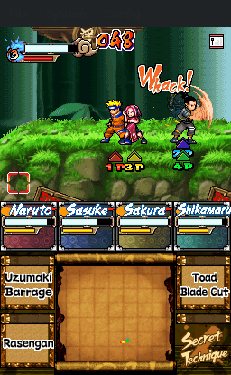

# Naruto: Ninja Council 3 — local CPU battles

The current patch adds **1–3 CPU players** in **Party Mode > Squad Leader**, then
lets you select a character for P1 and each CPU. It uses the native Party battle,
stage/time menus, results and rematch. See [play and patch instructions](dist/PARTY_CPU_README.md)
and [technical findings](notes/PARTY_CPU_MODE.md).

Desktop melonDS tests cover complete one-CPU and three-CPU Battle Royale rounds.
CPUs share basic AI; native character unlock and duplicate-character rules remain.
Delta device compatibility is not yet verified.

## Screenshots

Actual melonDS captures from the Party CPU patch. Press DS X or touch
**X ADD CPU** inside the next empty player box, choose each CPU's
fighter, then start a local match.

| Add a CPU in Squad Leader | Select a CPU character | Fight three CPUs |
| :---: | :---: | :---: |
|  |  |  |

## Required baseline ROM

Supply your own **Naruto - Ninja Council 3 (USA)** ROM, game code **AN4E**,
64 MiB (67,108,864 bytes). Place it in the project root with this exact filename:

```text
Naruto - Ninja Council 3 (USA).nds
```

Required SHA-256:

```text
6ca0d8af595730515acd591cbee3879a6c5ebaf6889422d375b1c841a832d5cc
```

Verify it from the project root:

```sh
sha256sum --check baseline-rom.sha256
```

The builders also validate this checksum before modifying a copy. ROMs, saves,
firmware, extracted game data and emulator states are local inputs/output and
are excluded from Git. No ROM is provided by this repository.

## Create the patched ROM

Use a BPS patcher with [dist/nc3-party-cpu.bps](dist/nc3-party-cpu.bps) and the
original baseline ROM. If the project-local Flips executable is installed:

```sh
mkdir -p workbench/build
tools/build/flips/flips --apply dist/nc3-party-cpu.bps \
  'Naruto - Ninja Council 3 (USA).nds' workbench/build/nc3-party-cpu-applied.nds
sha256sum workbench/build/nc3-party-cpu-applied.nds
```

Expected patched SHA-256:

```text
5b86da28089a9c67c6978e584a4d36e5290a2337caca47193e1bb033d434265f
```

Open that output explicitly in melonDS. Use a copy of your `.sav` progress file
with the patched ROM's base filename, and boot normally. Old save states restore
old game code. The research launcher `scripts/run_melonds.sh` opens the original
workbench ROM rather than this patched output. Apply the patch directly to the
original baseline ROM.

## Build from source

With Python 3, Clang/LLD and `llvm-nm`/`llvm-objcopy` installed:

```sh
python3 scripts/build_party_cpu.py
```

This reads the baseline ROM and writes the compiled payload, build manifest and
`nc3-party-cpu-research.nds` under `workbench/party-mode/build/`. Building the ROM
does not require the original research save states or emulator captures.
`scripts/record_party_validation.py` and `scripts/package_party_cpu.py` are
workbench release tools: they additionally require the local runtime evidence
and tools used for the recorded release. A fresh clone does not include that
private workbench. Committed validation reports describe the tested release;
they do not claim that every new build has been playtested.

## Repository layout

| Path | Purpose | Git |
| --- | --- | --- |
| `scripts/party_cpu/` | ARM9 hook source and linker script | Included |
| `scripts/` | Builders, emulator tooling and research helpers | Included |
| `notes/` | Reverse-engineering findings and validation limits | Included |
| `docs/screenshots/` | Actual emulator screenshots used above | Included |
| `dist/` | BPS patches, instructions and compact release reports | Included; ZIP packages ignored |
| `tools/` | Local tool installations and downloads | Only authored config/patches and source URLs included |
| `svs/` | Optional original research save states | Ignored |
| `workbench/` | Extracts, ROMs, captures, debugger data and generated builds | Ignored |

The existing paths are retained so scripts and research references keep working.
The repository contains the Party implementation and its supporting research.
See [tool layout](tools/README.md) and the
[Party implementation notes](notes/PARTY_CPU_MODE.md) for more context.
Before committing, review `git status --short`; use `git check-ignore -v PATH`
to inspect an ignore rule. Do not force-add private game inputs or workbench data.
